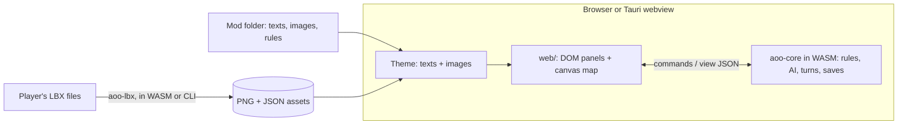

# Plan

## Goal

A web and desktop remake of Master of Orion 1 whose rules come from the 1oom engine,
rewritten in Rust and compiled to WebAssembly, with every text, picture and number in open
files so the game can be reskinned (the default theme turns planets into cities, fleets into
armies and empires into kingdoms) and modded without touching code.

## Decisions

1. **Rust core, no UI inside.** `crates/core` holds the whole game state and rules and talks
   JSON: `new game options -> state`, `command`, `end turn`, `view for one player`. It runs
   natively (tests, CLI) and as WebAssembly (web, desktop).
2. **One UI for web and desktop.** HTML/CSS for panels, menus and dialogs, canvas for the
   map. The desktop app is the same build inside Tauri's webview, so there is one code path.
3. **LBX only as an import source.** The engine never reads LBX. `crates/lbx` converts the
   player's own files into PNG and JSON, in the browser (IndexedDB) or with the CLI.
   No original asset is ever hosted or committed.
4. **Data over code.** Texts are JSON keyed by ID (`text/en.json`, theme and mod overrides),
   rules are a `Rules` object with defaults that a mod can override, images are looked up by
   alias with procedural fallbacks.
5. **Rewrite the UI, port the rules.** The 1993 UI (24.7k lines of 320x200 screens with
   blocking loops) is not ported; the event-driven DOM/canvas UI replaces it. The game logic
   is ported formula by formula.

## Architecture

## Port status (1oom `src/game` -> `crates/core`)

| 1oom | Rust | Status |
|---|---|---|
| `rnd.c` | `rng.rs` | Ported exactly |
| `game_new.c` (planets, names, homes) | `galaxy.rs` | Planet generation ported exactly; home placement and nebulae simplified/omitted |
| `game_misc.c` production, growth, tech output | `turn.rs` | Ported |
| `game_turn.c` eco, def, ship, ind, reserve, movement | `turn.rs` | Ported with 1oom's fix options; stargates, soil enrichment and atmospheric terraforming not yet |
| `game_tech.c` costs and thresholds | `rules.rs` | Cost formula and thresholds ported; research is linear (every tech number is a level) instead of choosing among available techs |
| `game_battle*.c` | `combat.rs` | Simplified: battles resolve in rounds of simultaneous fire, no tactical grid |
| `game_ground.c` | `combat.rs` | Ported (d100 + bonus rounds) |
| `game_shipdesign.c`, `game_design.c` | `rules.rs` (`Design`) | Fixed designs (the five MOO1 starting designs), editable through rules |
| `game_ai_classic.c` | `ai.rs` | Replaced by a compact strategy |
| `game_diplo.c`, `game_audience.c`, `game_spy.c`, `game_election.c`, `game_event.c`, `game_news.c` | - | Not yet: every empire is at war with every other |
| `game_save.c` | `serde` JSON | New format; MOO1 save import not yet |

## Milestones

### 0.1.0 (this release)
Playable game from start to conquest in the browser and on the desktop, two themes, LBX
import, mods, CI/CD, releases, website.

### 0.2.0: closer to MOO1
- Ship design screen (hulls, weapons, shields, armour, specials from `game_shiptech.c`).
- Research choices among available techs per tier (`game_tech.c`), tech names and texts.
- Soil enrichment, atmospheric terraforming, stargates, nebulae.
- Fleet order improvements: split/merge, relocation of new ships, scrap.

### 0.3.0: diplomacy and events
- Contact, treaties, trade and audiences (`game_diplo.c`, `game_audience.c`).
- Espionage and sabotage (`game_spy.c`), random events with EVENTMSG texts (`game_event.c`),
  the Galactic Council and diplomatic victory (`game_election.c`).
- Port of the classic AI.

### 0.4.0: battles and presentation
- Tactical combat on a grid (`game_battle_human.c`) with sprites from imported SHIPS.LBX or
  theme art.
- Music and sound: XMIDI to MIDI in the importer (`fmt_mus.c`) and a SoundFont synth.
- LBX import in a Web Worker, more aliases (ships, starmap, screens), fonts.

### Later
- Comparison harness against C 1oom (same seed, turn-by-turn state diff) to pin the rules.
- Translations, accessibility, touch controls, multiplayer by save exchange.

## Legal constraints

- The rules are derived from 1oom, so the project is GPL-2.0-only and its source is public.
- Original MOO1 assets are copyrighted: only the player's own files are imported, locally.
