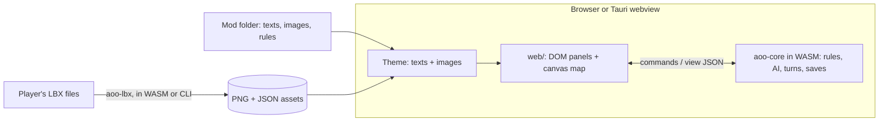

# Plan

## Goal

A web and desktop remake of Master of Orion 1 whose rules come from the 1oom engine,
rewritten in Rust and compiled to WebAssembly, with every text, picture and number in open
files so the game can be reskinned (the default theme turns planets into cities, fleets into
armies and empires into kingdoms) and modded without touching code.

## Decisions

1. **Rust core, no UI inside.** `crates/core` holds the whole game state and rules and talks
   JSON: `new game options -> state`, `command`, `end turn`, `view for one player`. It runs
   natively (tests, CLI) and as WebAssembly (web, desktop).
2. **One UI for web and desktop.** HTML/CSS for panels, menus and dialogs, canvas for the
   map. The desktop app is the same build inside Tauri's webview, so there is one code path.
3. **LBX only as an import source.** The engine never reads LBX. `crates/lbx` converts the
   player's own files into PNG and JSON, in the browser (IndexedDB) or with the CLI.
   No original asset is ever hosted or committed.
4. **Data over code.** Texts are JSON keyed by ID (`text/en.json`, theme and mod overrides),
   rules are a `Rules` object with defaults that a mod can override, images are looked up by
   alias with procedural fallbacks.
5. **Rewrite the UI, port the rules.** The 1993 UI (24.7k lines of 320x200 screens with
   blocking loops) is not ported; the event-driven DOM/canvas UI replaces it. The game logic
   is ported formula by formula.

## Architecture

## Port status (1oom `src/game` -> `crates/core`)

| 1oom | Rust | Status |
|---|---|---|
| `rnd.c` | `rng.rs` | Ported exactly |
| `util_math.c` | `umath.rs` | Ported exactly: integer angles, distances and movement in map units |
| `game_new.c` (nebulae, planets, names, homes, research lists) | `galaxy.rs`, `tech.rs` | Nebulae, planets and research lists ported; home placement simplified, so the same seed does not yet give 1oom's galaxy |
| `game_misc.c`, `game_planet.c` | `misc.rs` | Ported exactly (production, maintenance, research totals, waste, ranges, contact, visibility) |
| `game_turn.c` | `turn.rs` | Ported exactly, in `game_turn_process` order, with 1oom's default rules (MOO1 v1.3a fixes, no optional fixes) |
| `game_fleet.c` | `fleet.rs` | Ported exactly (fleet and transport lists keep 1oom's order) |
| `game_tech.c` | `tech.rs`, `rules.rs` | Ported exactly: research lists, interest, breakthroughs, field levels, `game_update_tech_util`, Orion and artifact loot |
| `game_battle.c` | `combat.rs` | Ported: battles two parties at a time per planet, results, retreat to the nearest colony |
| `game_battle_human.c`, `game_parsed.c` | `battle.rs` | Ported as a state machine (the turn pauses for a human battle): grid, movement and routes, initiative, beams, missiles in flight, asteroids, every combat special, retreat; the hit points of ship pictures (FIRING.LBX) are taken as the cell centre |
| battle AI of `game_ai_classic.c` | `battle_ai.rs`, `combat.rs` | Ported: targets, best range, evading missiles, retreat, and the computer-against-computer resolution (checked with the harness) |
| `fmt_mus.c` | `crates/lbx/src/music.rs` | Ported: XMIDI to MIDI; played by a built-in synthesizer (`web/src/audio.ts`) |
| `game_bomb.c` | `combat.rs` | Ported; damage still differs from 1oom in some harness turns |
| `game_turn_transport`, `game_ground.c` | `ground.rs` | Ported exactly |
| `game_shiptech.c`, `game_shipdesign.c`, `game_design.c` | `data.rs` (generated), `design.rs` | Ported: part tables, cost, space, engines, hit points, starting designs |
| `game_ai_classic.c` | `ai.rs`, `ai_diplo.rs`, `audience.rs` | Ported: `turn_p1` (scouts, colony ships, fronts, attack, defence, idle fleets, transports, reserve, taxes), `turn_p2` (design, scrapping, production), `turn_p3` (sliders, research focus, security, spies), new-game setup, diplomacy, audiences, votes; Classic and Classic+ |
| `game_diplo.c`, diplomacy steps of `game_turn.c` | `diplo.rs` | Ported (relations, moods, treaties, trade, contact, battle consequences) |
| `game_audience.c` | `audience.rs` | Ported as request/answer steps instead of a blocking dialogue |
| `game_spy.c` | `spy.rs` | Ported; tech groups and tiers (in RESEARCH.LBX in MOO1) are derived from the tech names |
| `game_event.c`, `game_turn_coup` | `events.rs` | Ported: all 16 events, monsters, rebellions, coups; some events still differ from 1oom in harness turns; texts are our own, or MOO1's from an imported EVENTMSG.LBX |
| `game_election.c` | `council.rs` | Ported, with the vote and the acceptance as player commands |
| `game_news.c`, `game_stat.c` | `events.rs`, `misc.rs`, `web/src/news.ts` | The GNN newscast with the statistics news; other reports in the turn summary |
| `lbxfont.c`, `fmt_sfx.c` | `crates/lbx/src/font.rs`, `sfx.rs` | MOO1 fonts to TrueType, sound effects to WAV |
| `game_save.c` | `serde` JSON; `crates/harness/src/oom.rs` | New format; 1oom saves are read by the harness (not yet by the game) |

## Milestones

### 0.1.0 (done)
Playable game from start to conquest in the browser and on the desktop, two themes, LBX
import, mods, CI/CD, releases, website.

### 0.2.0: closer to MOO1 (done)
- Ship design screen with every MOO1 part (`game_shiptech.c`, `game_design.c`).
- Research choices among the available techs per tier (`game_tech.c`), tech names.
- Soil enrichment, atmospheric terraforming, stargates, nebulae.
- Fleet orders: split (send part of an orbit), automatic merge in orbit, rally points for
  new ships, scrapping. Orbital bombing and transport losses as in MOO1.
- Still open from this list: tech descriptions (MOO1 keeps them in RESEARCH.LBX, to be
  imported), the effects of combat specials that need the tactical grid.

### 0.3.0: diplomacy and events (done)
- Contact, treaties, trade and audiences (`game_diplo.c`, `game_audience.c`).
- Espionage and sabotage (`game_spy.c`), random events with EVENTMSG texts (`game_event.c`),
  the Galactic Council and diplomatic victory (`game_election.c`).
- The diplomacy, voting and spying of the classic AI.
- Still open: the classic AI's fleet, production and design routines (`turn_p1`, `turn_p3`
  sliders, `design_ship`), the GNN newscast screen.

### 0.4.0: battles and presentation (done)
- Tactical combat on a grid (`game_battle_human.c`) with sprites from imported SHIPS.LBX or
  theme art.
- Music and sound: XMIDI to MIDI in the importer (`fmt_mus.c`) and a synthesizer (built in,
  no SoundFont needed); procedural sound effects.
- Combat specials (repulsor, stasis, black hole, teleporter, ...), retreat.
- LBX import in a Web Worker, more aliases (ships, battle screens, missiles, music), tech
  descriptions from RESEARCH.LBX.
- Still open: MOO1 fonts, the ground battle and GNN newscast screens, sound effects from
  SOUNDFX.LBX.

### 0.5.0: the classic AI and the comparison harness (done)
- The rest of the classic AI (`turn_p1`, `turn_p2`, `turn_p3`, new-game setup), Classic and
  Classic+.
- Turn processing, production, fleets, research and ground combat ported exactly, with
  integer map geometry (`util_math.c`).
- Comparison harness against C 1oom ([HARNESS.md](HARNESS.md)): the first 40 years of a
  computer-only game are identical turn by turn; about half the turns of longer games.

### 0.6.0: presentation (done)
- MOO1 fonts (FONTS.LBX to TrueType), the ground battle screen (`uiground.c`) and the GNN
  newscast (`uinews.c`) with LANDING.LBX and NEWSCAST.LBX art, sound effects from
  SOUNDFX.LBX (`fmt_sfx.c`).

### 0.7.0: exact rules (done)
- Random events, orbital bombing, battle sequencing, diplomacy and the AI's reactions driven
  to 1oom parity with the harness: 86% of the turns of five 100-250 year games identical.
- Still open: the same galaxy from the same seed, the last relation and battle differences,
  audiences and human-only screens.

### 0.8.0: Spanish
- Spanish translation of both themes and a language selector.

### Later
- Accessibility, touch controls, multiplayer by save exchange, MOO1 save import.

## Legal constraints

- The rules are derived from 1oom, so the project is GPL-2.0-only and its source is public.
- Original MOO1 assets are copyrighted: only the player's own files are imported, locally.
